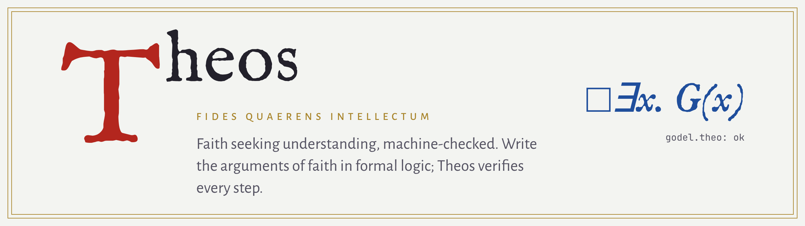
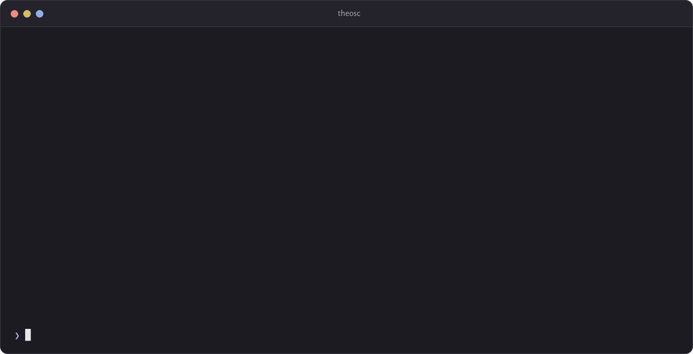
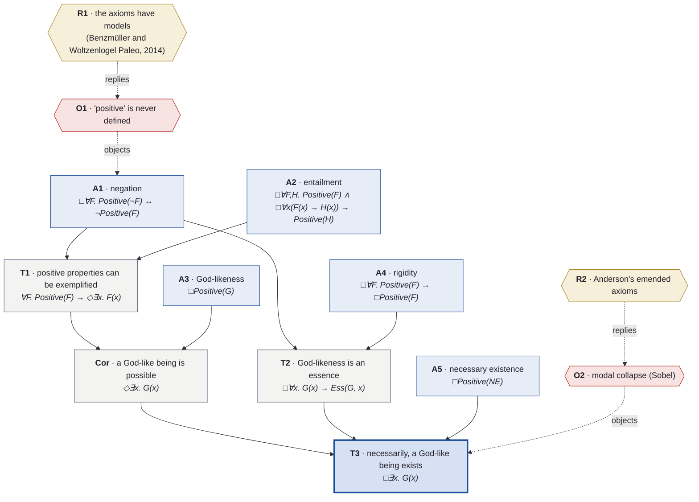
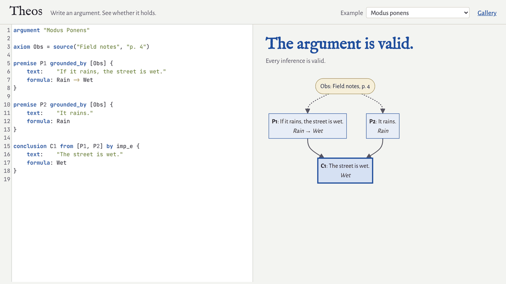
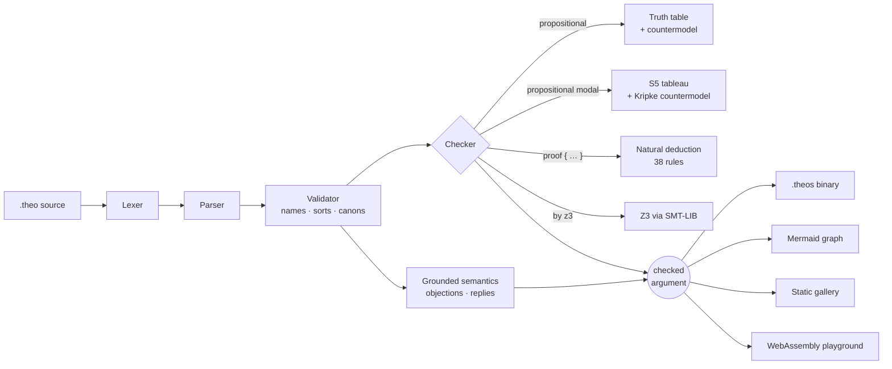
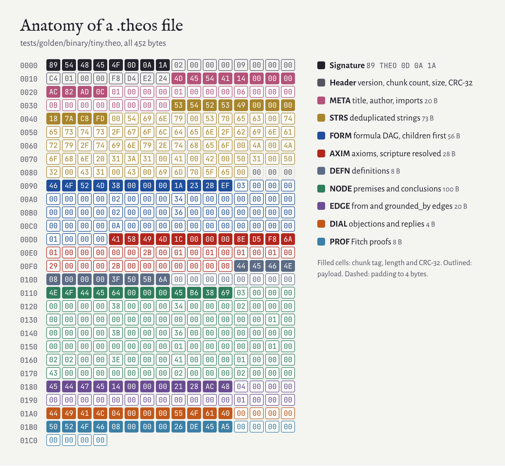

<div align="center">

<picture>
  <source media="(prefers-color-scheme: dark)" srcset="docs/assets/banner-dark.png">
  
</picture>

<br>

[](https://github.com/JFrusher/theos-engine/actions/workflows/ci.yml)
[](https://github.com/JFrusher/theos-engine/actions/workflows/web.yml)
[](https://github.com/JFrusher/theos-engine/releases)
[](#build-from-source)
[](LICENSE)

**10** formalized arguments &nbsp;·&nbsp; **38** inference rules &nbsp;·&nbsp; **4** checking engines &nbsp;·&nbsp; **87** tests &nbsp;·&nbsp; fuzzed in CI

<a href="https://jfrusher.github.io/theos-engine/"></a>
&nbsp;
<a href="https://jfrusher.github.io/theos-engine/gallery/"></a>

</div>

<br>

Christians have argued for God with rigour since Anselm and Aquinas. **Theos makes that rigour checkable.** You write an argument the way a theologian would, each premise in plain words, grounded in Scripture, the Fathers or first principles. Next to the words you write the claim in formal logic, and the compiler `theosc` verifies that every step follows. When a step fails, it shows you why: the line that breaks, or a counterexample world where the premises hold and the conclusion doesn't.

It is a real compiler written in modern C++23. It has its own natural-deduction proof checker, an S5 modal tableau and a Z3 bridge, a binary file format designed from the byte up, and a WebAssembly build that puts the whole checker in your browser. Gödel's ontological argument ships in the library, and every step of it is machine-checked.

<p align="center">
  
</p>

> [!NOTE]
> Theos checks **validity**, that the conclusion follows from the premises. Whether the premises are *true* is the debate the argument invites, so Theos records that too: every premise names its sources, and objections and replies are part of the file.

## Highlights

<table>
<tr>
<td width="50%" valign="top">

### ⊢&nbsp; A proof checker, not a linter
Fitch-style natural deduction covering propositional, first-order, identity, **S5 modal** and **higher-order** reasoning. Simple inferences need no proof at all: truth tables and an S5 tableau decide them, and print a countermodel when they fail. Any step can also be handed to the **Z3** SMT solver.

</td>
<td width="50%" valign="top">

### ✠&nbsp; Grounded in Scripture and tradition
Premises cite `scripture(...)`, `source(...)` or `principle(...)`. References are checked against the **Protestant, Catholic and Orthodox** canons and the **Quran**, down to chapter and verse, so `John 22:1` is an error.

</td>
</tr>
<tr>
<td width="50%" valign="top">

### ⚔&nbsp; Objections answered, in the open
Objections and replies are first-class. Theos evaluates the debate with **Dung's grounded semantics** and shows which claims still stand. A conclusion attacked by an unanswered objection is marked *contested*, never quietly passed.

</td>
<td width="50%" valign="top">

### ◈&nbsp; One engine, everywhere
The same C++ core runs as a CLI on **Linux and Windows**, as **WebAssembly** in the playground, and compiles arguments to **`.theos`**, a chunked, CRC-protected, fuzzed binary format with a full spec.

</td>
</tr>
</table>

## Quickstart

Grab a build for Linux or Windows from [**Releases**](https://github.com/JFrusher/theos-engine/releases), or [build from source](#build-from-source). Then:

```sh
theosc check library/arguments/godel.theo                # every step machine-checked
theosc check examples/affirming_the_consequent.theo      # rejected, with a counterexample
theosc analyze library/arguments/kalam.theo              # premises, chains, objections
```

Or skip the install and open the [**playground**](https://jfrusher.github.io/theos-engine/). New to the language? The [**user guide**](docs/guide.md) builds an argument from scratch in eight short steps.

## Gödel, machine-checked

Kurt Gödel left a short ontological proof in his notebooks, and Dana Scott later tidied it into a form logicians could work with. It reasons about properties of properties, in modal logic. That makes it famously hard to verify by hand, and it is the flagship of the Theos library. Here are the definitions and the first axiom, exactly as they appear in [`library/arguments/godel.theo`](library/arguments/godel.theo):

```theo
define G(x)        := forall F:prop. Positive(F) -> F(x)
define Ess(F:prop, x) := F(x) & (forall H:prop. H(x) -> []forall y. (F(y) -> H(y)))
define NE(x)       := forall F:prop. Ess(F, x) -> []exists y. F(y)

premise A1 grounded_by [Godel, Scott] {
    text:    "Necessarily, a property is positive exactly when its negation is not."
    formula: [](forall F:prop. Positive(\x. ~F(x)) <-> ~Positive(F))
}
```

From five axioms, four natural-deduction proofs (T1, Cor, T2 and T3) reach the conclusion `□∃x. G(x)`, *necessarily, a God-like being exists*. The checker verifies each of their lines. Change any one of them and `theosc` names the line that no longer follows, as the recording above shows. Here is the structure of the argument, condensed from `theosc export --format mermaid` (the full export also carries every premise's wording and its sources):



## Write it, see it hold

The [playground](https://jfrusher.github.io/theos-engine/) runs the checker in your browser as WebAssembly, with no server involved. As you type, it re-checks the argument, redraws the graph and marks failing lines. Here it rejects affirming the consequent, then accepts the repaired argument:

<p align="center">
  
</p>

The [gallery](https://jfrusher.github.io/theos-engine/gallery/) gives every library argument its own page. Each page shows the graph, sources, Fitch-style proofs and objections, and is generated by `theosc site`.

## The library

Ten arguments, each passing `theosc check`. Theos does not flatter its own side: where a recorded objection still stands, the verdict says so.

| Argument | Checked by | Grounded in | Verdict |
|---|---|---|---|
| [Gödel's ontological argument](library/arguments/godel.theo) (Scott's version) | 4 proofs, higher-order S5 | Gödel 1970, Scott 1972 | ✅ valid · 2 objections answered |
| [The modal ontological argument](library/arguments/plantinga.theo) (Plantinga) | S5 tableau, `box_e` | *The Nature of Necessity* | ✅ valid · objection answered |
| [The ontological argument](library/arguments/anselm.theo) (Anselm) | proof, first-order | *Proslogion* ch. 2 | ✅ valid · objection answered |
| [The kalam cosmological argument](library/arguments/kalam.theo) | 2 proofs, first-order | Genesis 1:1, al-Ghazali, Craig | ✅ valid · 2 objections answered |
| [The First Way](library/arguments/aquinas_first_way.theo) (Aquinas) | 2 proofs, first-order | *Summa* I q.2 a.3, Psalm 102, Hebrews 1 | ✅ valid |
| [The argument from contingency](library/arguments/leibniz.theo) (Leibniz) | 2 proofs, imports `std/principles` | *Monadology* §§ 36–38 | ✅ valid · objection answered |
| [The moral argument](library/arguments/moral_argument.theo) | truth table | Craig, *Reasonable Faith* | ✅ valid · objection answered |
| [The resurrection](library/arguments/resurrection.theo) (minimal facts) | truth table | 1 Corinthians 15, Mark 16, Luke 24 | ✅ valid · objection answered |
| [The Third Way](library/arguments/aquinas_third_way.theo) (Aquinas) | 2 proofs, first-order | *Summa* I q.2 a.3 | ⚠️ valid, but P1 falls to the quantifier-shift objection (Kenny) |
| [The logical problem of evil](library/arguments/problem_of_evil.theo) (Mackie) | truth table | Mackie 1955 | ⚠️ valid, but P2 falls to the free-will defence (Plantinga) |

## How it works



Each inferred node is justified in exactly one way. With no justification written, the checker *decides* the inference itself. `by rule` applies a single rule, `by z3` asks the solver, and `proof { … }` gives a full natural-deduction proof:

| Fragment | Engine | When it fails you get |
|---|---|---|
| Propositional | Truth table (up to 20 atoms) | A counterexample row: `Rain = false, Wet = true` |
| Propositional S5 | Labelled tableau, constant domains | A Kripke countermodel: one valuation per world |
| First-order, identity, S5, higher-order | Your proof, checked line by line | The exact line and rule that does not apply |
| Anything in the SMT fragment | Z3 (optional) | Z3's countermodel |

The rules, from `and_i` to `barcan`, are specified in [docs/spec/proofs.md](docs/spec/proofs.md).

## The `.theos` binary format

`theosc build` compiles a checked argument into `.theos`, a format designed at the byte level. It borrows PNG's signature and chunk layout and stores a formula DAG whose nodes always reference earlier ones, so a reader decodes it in a single pass. Every byte of a small file:

<p align="center">
  <picture>
    <source media="(prefers-color-scheme: dark)" srcset="docs/assets/theos-format-dark.png">
    
  </picture>
</p>

- **Corruption-evident.** The signature `89 54 48 45 4F 0D 0A 1A` catches 7-bit and line-ending damage, and CRC-32 covers the header and every chunk.
- **Evolvable.** As in PNG, a lowercase tag marks an ancillary chunk, which readers skip, and an uppercase tag marks a critical chunk, which they reject if unknown.
- **O(1) access.** Records are fixed-width and little-endian, reference each other by index, and keep payloads 4-byte aligned.
- **Hostile-input safe.** Every offset and index is bounds-checked and the padding must be zero. The reader is fuzzed with libFuzzer in CI.

`theosc inspect --chunks` prints the chunk table of any file. The full spec, with an annotated hex walkthrough, is [docs/spec/theos-v2.md](docs/spec/theos-v2.md).

## Going deeper

<details>
<summary><b>A tour of the language</b></summary>
<br>

Every claim carries `text` for readers and a `formula` for the checker. Formulas accept ASCII or Unicode (`[]` or `□`, `forall` or `∀`).

```theo
argument "The Kalam Cosmological Argument" by "William Lane Craig, after al-Ghazali"

axiom ExNihilo = principle("Nothing comes from nothing.")
axiom Gen1     = scripture(protestant, "Genesis 1:1")

premise P1 grounded_by [ExNihilo] {
    text:    "Whatever begins to exist has a cause."
    formula: forall x. Began(x) -> exists y. Causes(y, x)
}

premise P2 grounded_by [Gen1] {
    text:    "The universe began to exist."
    formula: Began(universe)
}

conclusion C1 from [P1, P2] {
    text:    "Therefore the universe has a cause."
    formula: exists y. Causes(y, universe)
    proof {
        1. forall x. Began(x) -> exists y. Causes(y, x)      premise P1
        2. Began(universe)                                    premise P2
        3. Began(universe) -> exists y. Causes(y, universe)   forall_e 1
        4. exists y. Causes(y, universe)                      imp_e 3, 2
    }
}

objection O1 against P1 {
    text: "Quantum events, such as radioactive decay, seem to begin without a cause."
}

reply R1 to O1 {
    text: "Quantum events arise within a vacuum governed by physical law, which is not nothing."
}
```

Arguments can `import` each other and the standard library, e.g. `import "std/principles"` for the principle of sufficient reason. The full grammar is in [docs/spec/language.md](docs/spec/language.md).

</details>

<details>
<summary><b>Scripture references are checked</b></summary>
<br>

```text
$ theosc check scripture.theo
scripture.theo:3:1: error: chapter out of range in 'John 22:1': John has 21 chapters
    axiom J  = scripture(protestant, "John 22:1")
    ^~~~~~~~~~~~~~~~~~~~~~~~~~~~~~~~~~~~~~~~~~~~~
scripture.theo:4:1: error: verse out of range in '2:300'
    axiom Q  = scripture(quran, "2:300")
    ^~~~~~~~~~~~~~~~~~~~~~~~~~~~~~~~~~~~
scripture.theo:5:1: error: unknown book 'Tobit' in the protestant canon
    axiom T  = scripture(protestant, "Tobit 1:1")
    ^~~~~~~~~~~~~~~~~~~~~~~~~~~~~~~~~~~~~~~~~~~~~
```

`Tobit 1:1` is fine under `catholic` or `orthodox`, the canons that include it.

</details>

<details>
<summary><b>CLI reference</b></summary>
<br>

| Command | Does |
|---|---|
| `theosc check <file.theo>` | Parse, validate and check every inference |
| `theosc analyze <file.theo>...` | Premise load, longest chains, unused citations, objection status; shared premises across files |
| `theosc prove <file.theo>` | Send every inference to Z3 for a second opinion |
| `theosc export <file.theo> --format mermaid\|smtlib [-o out]` | Argument graph, or the SMT-LIB scripts |
| `theosc build <file.theo> [-o out.theos]` | Compile to the binary format |
| `theosc inspect <file.theos> [--chunks]` | Decode a binary, or show its chunk table and hex |
| `theosc site <file-or-dir>... -o <dir>` | Generate the static gallery |

`-L <dir>` adds an import search directory. Diagnostics are printed as `file:line:col: error: message` with a caret under the source. Exit codes: `0` ok, `1` invalid input, `2` usage error.

</details>

<details>
<summary><b>Project layout</b></summary>
<br>

```text
include/theos/   public headers
src/core/        lexer, parser, validator, sorts, checker, S5 tableau, proof checker,
                 dialectic, analysis, SMT, binary format, exporter, site, driver
src/cli/         theosc
src/wasm/        WebAssembly entry point for the playground
web/             playground and gallery styles, site assembly
library/         the argument gallery and the importable standard library
docs/            user guide and the five specifications
fuzz/            libFuzzer targets and seed corpora
tests/           Catch2 unit tests, golden files, browser smoke tests
tools/readme/    regenerates the images in this README from the real tool
```

</details>

## Build from source

You need CMake 3.20+ and a C++23 compiler: GCC 13+, Clang 19+, or MinGW-w64 GCC 13+ via MSYS2. CMake fetches Catch2 for the tests. [Z3](https://github.com/Z3Prover/z3) is optional; it powers `by z3` and `theosc prove` (`apt install z3`, or `pacman -S mingw-w64-ucrt-x86_64-z3`).

```sh
cmake -B build -DCMAKE_BUILD_TYPE=Release
cmake --build build
ctest --test-dir build --output-on-failure
```

On Windows, run the same commands from an MSYS2 UCRT64 shell. For fuzzing, configure with `-DCMAKE_CXX_COMPILER=clang++-19 -DTHEOS_FUZZ=ON -DTHEOS_BUILD_TESTS=OFF`. The WebAssembly build is described in [web/README.md](web/README.md). The images in this README are regenerated from the real tool by `node tools/readme/render.cjs`.

---

<div align="center">

*Credo ut intelligam.* (I believe, that I may understand.)

[Roadmap](ROADMAP.md) · [Changelog](CHANGELOG.md) · [User guide](docs/guide.md) · [MIT License](LICENSE)

</div>
